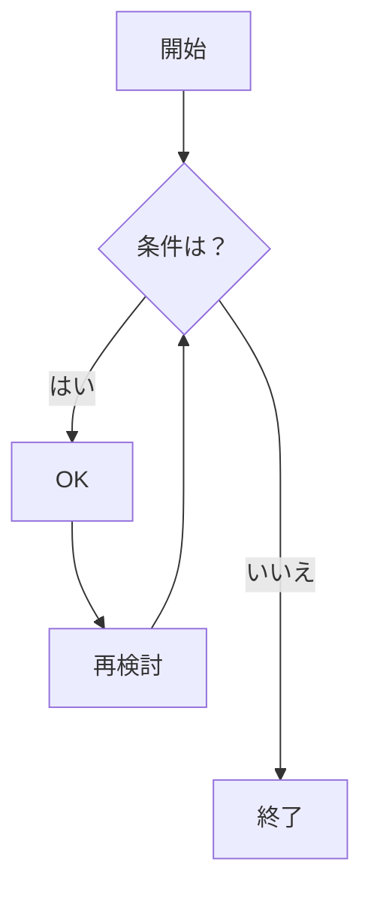



見出しの例です。次のMarkdownの書き方で見出しを使えます。たとえば、見出し1には `#` を、見出し6には `######` を使います。

# 見出し1

## 見出し2

### 見出し3

#### 見出し4

##### 見出し5

###### 見出し6

---

### 強調

斜体（イタリック）は、_アスタリスク_ または _アンダースコア_ で囲みます。

太字は、**アスタリスク** または **アンダースコア** 2つで囲みます。

組み合わせることもできます：**アスタリスクと _アンダースコア_**。

取り消し線はチルダ2つで囲みます：~~これは取り消し~~。

---

### ボタン



---

### リンク

[インライン形式のリンク](https://www.google.com)

[タイトル付きのインライン形式のリンク](https://www.google.com "Googleのホームページ")

[リポジトリ内のファイルへの相対リンク](../blob/master/LICENSE)

URLや山かっこで囲んだURLは、自動的にリンクになります。
<http://www.example.com> または <http://www.example.com>、場合によっては
example.com のようにも書けます（GitHubなど一部の環境では自動リンクされません）。

参照形式のリンクは、後から定義を書くこともできます。

---

### 段落

これはダミーテキストです。段落の表示を確認するための文章です。実際の文章に差し替えてご利用ください。文章の長さや行間、文字の大きさなど、レイアウトの見え方を確認するために使用しています。これはダミーテキストです。段落の表示を確認するための文章です。実際の文章に差し替えてご利用ください。文章の長さや行間、文字の大きさなど、レイアウトの見え方を確認するために使用しています。

---

### 番号付きリスト

1. リスト項目
2. リスト項目
3. リスト項目
4. リスト項目
5. リスト項目

---

### 箇条書きリスト

- リスト項目
- リスト項目
- リスト項目
- リスト項目
- リスト項目

---

### お知らせ


これはメモの例です。



これは引用の例です。



これはヒントの例です。



これは情報の例です。



これは警告の例です。


---

### タブ




#### こんにちは、これはタブです

これはダミーテキストです。タブの中に表示する内容を確認するための文章です。実際の内容に差し替えてご利用ください。





#### 2つ目のタブの見出し

これはダミーテキストです。タブの中に表示する内容を確認するための文章です。実際の内容に差し替えてご利用ください。

これはダミーテキストです。複数の段落を含む場合の表示を確認するための文章です。





#### 3つ目のタブの見出し

これはダミーテキストです。タブの中に表示する内容を確認するための文章です。実際の内容に差し替えてご利用ください。

これはダミーテキストです。複数の段落を含む場合の表示を確認するための文章です。




---

### アコーディオン



- これはダミーテキストです。
- これはダミーテキストです。
- これはダミーテキストです。





- これはダミーテキストです。
- これはダミーテキストです。
- これはダミーテキストです。





- これはダミーテキストです。
- これはダミーテキストです。
- これはダミーテキストです。



---

### コードとシンタックスハイライト

これは `インラインコード` の例です。

```javascript
var s = "JavaScript syntax highlighting";
alert(s);
```

```python
s = "Python syntax highlighting"
print s
```

```c  { linenos=true }
#include <stdio.h>

int main(void)
{
    printf("hello, world\n");
    return 0;
}
```



---

### 引用

> これは引用のダミーテキストです。引用ブロックの表示を確認するための文章です。

---

### 表

| 表は          |   とても    | 便利 |
| ------------- | :---------: | ---: |
| 3列目は       |   右揃え    | ¥1600 |
| 2列目は       |  中央揃え   |  ¥12 |
| しま模様も    |  きれい     |   ¥1 |

---

### 画像



---

### ギャラリー



---

### スライダー



---

### YouTube動画



---

### 動画ファイル


